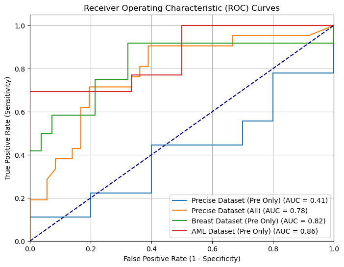

# PRECISE on single-cell datasets: predicting treatment response across studies

This repository applies the [PRECISE](https://github.com/NKI-CCB/PRECISE) transfer-learning
pipeline to three published single-cell RNA-seq datasets and compares how well it predicts
treatment response in each. It also contains an exploratory analysis (EDA) of how the
datasets differ, to help explain differences in performance.

The workflow follows the approach described in: https://www.nature.com/articles/s41698-025-00883-z

## Overview

1. Run the PRECISE pipeline separately on each dataset to obtain predictions of treatment
   response.
2. Compare performance across datasets (ROC curves and AUCs).
3. Explore dataset properties (number of patients, cells per patient, and so on) to see what
   might account for the differences.

## Datasets

The data are **not included** in this repository. See [`data/README.md`](data/README.md) for
download instructions, accessions and access notes.

| Dataset | Cancer type | Treatment | Source |
|---|---|---|---|
| GSE120575 | Melanoma | Checkpoint inhibitors | GEO |
| Bassez et al. 2021 | Breast cancer | Anti-PD-1 | GEO |
| GSE235923 | Pediatric AML | Chemotherapy | GEO |

## Repository structure

```
precise-scrna-comparison/
├── README.md
│
├── external/
│   └── PRECISE/                             # original PRECISE repo (git submodule)
│
├── notebooks/
│   ├── 01_run_precise_GSE120575.ipynb
│   ├── 02_run_precise_Bassez_BC.ipynb
│   ├── 03_run_precise_GSE235923.ipynb
│   └── 04_eda_dataset_comparison.ipynb
│
├── data/                                    # not tracked by git
│   ├── README.md                            # data sources and download instructions
├── results/
│   ├── GSE235923_ped_AML_6rel_14resp/                           # PRECISE predictions per dataset
│   ├── biokey_small_paper_run/
│   ├── precise_pre_treatment/
│
└── figures/
    ├── ROC_curves_all.png
    ├── cell_per_patient_boxplot.png
    └── cells_n_per_dataset.png
```

## Getting started

### 1. Clone the repository with the PRECISE submodule

```bash
git clone --recurse-submodules https://github.com/<your-username>/precise-scrna-comparison.git
cd precise-scrna-comparison
```

If you already cloned without `--recurse-submodules`:

```bash
git submodule update --init --recursive
```

### 2. Create the environment

```bash
conda env create -f environment.yml
conda activate precise-scrna
```

Main dependencies: Python 3.12.12, scanpy, anndata, numpy, pandas, matplotlib,
scikit-learn, plus the requirements of PRECISE (see `external/PRECISE`).

### 3. Download the data

Follow [`data/README.md`](data/README.md) and place each dataset in `data/raw/`.

### 4. Run the notebooks in order

| Notebook | Purpose | Main outputs |
|---|---|---|
| `01_run_precise_GSE120575.ipynb` | Preprocess and run PRECISE on the melanoma dataset | `results/GSE120575/`, AUC |
| `02_run_precise_Bassez_BC.ipynb` | Preprocess and run PRECISE on the breast cancer dataset | `results/Bassez_BC/`, AUC |
| `03_run_precise_GSE235923.ipynb` | Preprocess and run PRECISE on the pediatric AML dataset | `results/GSE235923/`, AUC |
| `04_eda_dataset_comparison.ipynb` | Compare dataset properties against AUC | `results/dataset_summary.csv`, `figures/` |

Notebook `04` expects the AnnData objects to be loaded (or read from `data/processed/`) and
the AUC for each dataset to be available (TODO: point to `results/auc_summary.csv`).

## Results

TODO: add a short summary and the main figure once finalized, for example:



| Dataset | Patients | Cells | AUC |
|---|---|---|---|
| GSE120575 | 57 | 16,291 | 0.78 |
| Bassez et al. 2021 | 40 | 30395 | 0.82 |
| GSE235923 | 19 | 57520 | 0.86 |

## Notes and limitations

- The three datasets differ in cancer type, treatment, sequencing platform, timepoint, and how
  "response" is defined, so AUCs are not directly comparable as a measure of method quality.
- With three datasets, comparisons against dataset properties (such as cohort size) are
  descriptive only and should not be read as statistical associations.

## Citations

If you use this work, please cite the underlying methods and datasets.

**Methods**

- PRECISE: Mourragui SMC, Loog M, van de Wiel MA, Reinders MJT, Wessels LFA. PRECISE: a
  domain adaptation approach to transfer predictors of drug response from pre-clinical models
  to tumors. *Bioinformatics* 35(14):i510-i519 (2019). Code:
  <https://github.com/NKI-CCB/PRECISE> 

**Datasets**

- Sade-Feldman M, et al. *Cell* (2018). GEO: GSE120575. (TODO: confirm full citation)
- Bassez A, et al. *Nature Medicine* 27, 820-832 (2021). DOI: 10.1038/s41591-021-01323-8.
- Thomas BE, et al. (2023). GEO: GSE235923. (TODO: add full citation)

